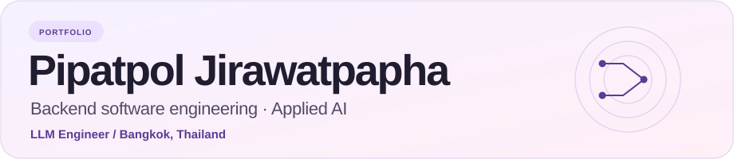
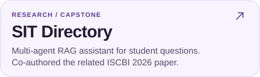
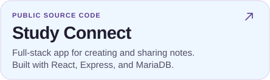
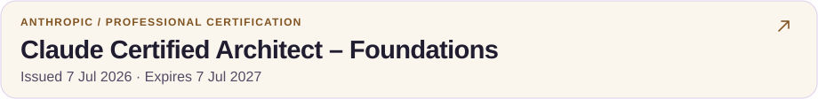

<picture>
  <source media="(prefers-color-scheme: dark)" srcset="./assets/header-dark.svg">
  
</picture>

  <a href="https://www.linkedin.com/in/pipatpol-jirawatpapha/">LinkedIn</a>
  &nbsp;·&nbsp;
  <a href="./certificates/README.md">Certificate log</a>

I build microservices and APIs, integrate services, and develop conversational AI features. I also design agent workflows and evaluate LLM outputs.

B.Sc. in Computer Science, KMUTT · Second Class Honours

## Featured work

<a href="https://doi.org/10.1109/ISCBI69404.2026.11496000"><picture>
  <source media="(prefers-color-scheme: dark)" srcset="./assets/sit-dark.svg">
  
</picture></a>
<a href="https://github.com/hideonbug-ssi/Study-Connect"><picture>
  <source media="(prefers-color-scheme: dark)" srcset="./assets/study-dark.svg">
  
</picture></a>

[Read the SIT Directory paper](https://doi.org/10.1109/ISCBI69404.2026.11496000) · [Browse Study Connect source](https://github.com/hideonbug-ssi/Study-Connect)

## Certification

<a href="https://www.credly.com/badges/2a549102-a01b-4424-a0ad-eb21b9ba21ec/linked_in?t=ths9aw"><picture>
  <source media="(prefers-color-scheme: dark)" srcset="./assets/credential-dark.svg">
  
</picture></a>

[Verify on Credly](https://www.credly.com/badges/2a549102-a01b-4424-a0ad-eb21b9ba21ec/linked_in?t=ths9aw) · [Browse certificate log](./certificates/README.md)

## Technical stack

- **Languages:** Go, Python, JavaScript, TypeScript, SQL
- **Backend:** PostgreSQL, Redis, Kafka, FastAPI, Docker, Kubernetes
- **Applied AI:** Retrieval-augmented generation (RAG), agent workflows, prompt iteration, LLM evaluation

Additional coursework

- [Java data structures and algorithms](https://github.com/hideonbug-ssi/CSC209)
- [Dart and Flutter apps](https://github.com/hideonbug-ssi/CSC234)

